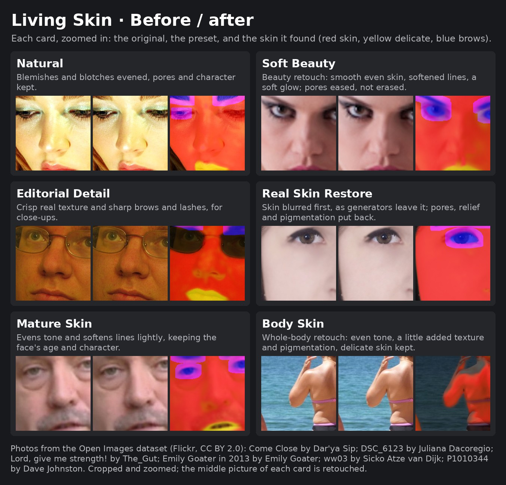

# Living Skin

Skin retouching for **Forge, reForge and Forge Classic (Neo)**. Living Skin detects visible skin across the face and body, then adjusts blemishes, uneven colour, fine texture and creases while aiming to preserve natural boundaries, tonal variation and the light and shade that give skin its shape. Delicate areas can be included and are treated more lightly.

## Install

Install the extension through your WebUI's extension manager or copy this folder into `extensions/`, then restart. The included installer checks for `facexlib` and installs it if it is missing. Detection models are downloaded on first use into `models/LivingSkin` (about 80 MB in total).

## What it does

| Control group | Purpose |
|---|---|
| **Skin detection** | Finds faces and separates people from the background, then looks for skin across the detected person. **Skin match** broadens or narrows the search; **Show skin mask** previews the detected regions. |
| **Tone and blemishes** | **Even skin** reduces spots and blotches. **Even colour** reduces redness and uneven colour. **Soften lines** lifts pronounced creases without trying to erase them. |
| **Texture** | **Pores** controls the existing fine texture; **Add texture** and **Texture size** can restore fine relief to overly smooth generated skin. |
| **Natural variation** | **Natural pigmentation** adds restrained tonal variation and freckles. **Glow** adds a subtle sheen to lit skin. **Brows & lashes** adds definition when a face is present. |

The retouch separates changes by scale, similar in spirit to frequency separation. It aims to even colour and surface detail without flattening the underlying form. Skin detection is not infallible: skin-coloured clothing, difficult shadows or unusual lighting can affect the mask, so inspect the preview when the result matters.

## Presets

| Preset | Starting point |
|---|---|
| **Natural** | Light blemish and colour correction while keeping existing texture. |
| **Clean Even Tone** | More even-looking colour with texture retained. |
| **Soft Beauty** | Softer lines and a gentle glow, without deliberately removing all pores. |
| **Editorial Detail** | More visible texture and definition for close-ups. |
| **Real Skin Restore** | Adds fine relief and tonal variation to plastic-smooth skin. |
| **Mature Skin** | Light correction while retaining age and character. |
| **Body Skin** | A whole-body starting point with modest texture and pigmentation. |
| **Sun-Kissed** | Warm tonal variation, freckles and a light sheen. |

Presets are starting points, not fixed filters. Select one from the carousel and adjust **Overall strength** or individual controls to suit the image. **Reset** returns to the defaults, which use Natural settings. Presets do not change the skin-detection options.

## Workflow

For a multi-stage image-finishing workflow, Living Skin fits after basic correction and before simulated lens effects or final grading:

1. [Auto Color Corrector](https://github.com/sca-285/sd-forge-auto-color-corrector) for basic colour and exposure correction.
2. **Living Skin** for skin retouching.
3. [Optical Realism](https://github.com/sca-285/sd-forge-optical-realism) for lens and optical effects.
4. [Digital Mastering](https://github.com/sca-285/sd-webui-digital-mastering) for finishing and grading.

This order is a suggestion, not a requirement. You can use Living Skin on its own.

## Generation info and X/Y/Z plot

- Settings that differ from the defaults are stored in PNG generation information and can be restored through the WebUI's **Send to / Paste** workflow.
- The X/Y/Z plot axes are grouped under `[LS]`: Preset, Overall strength, Even skin, Even colour, Soften lines, Pores, Add texture, Natural pigmentation, Glow, Brows & lashes and Skin match. A plot cell that sets one of these values enables the retouch for that cell.
- Added texture and pigmentation follow the image seed, so they can be reproduced with the same seed and settings.

## Credits and licence

- [facexlib](https://github.com/xinntao/facexlib) (MIT) provides face detection, face parsing and person matting. Model notices are listed in `NOTICE.md`.
- Preset icons and the reference image use photographs from the Open Images dataset under CC BY 2.0. Photographer credits are in `preset_icons/CREDITS.md` and on the reference image. The lettering uses Bebas Neue under the SIL Open Font License 1.1.

This extension is released under the MIT License. See `LICENSE`.
